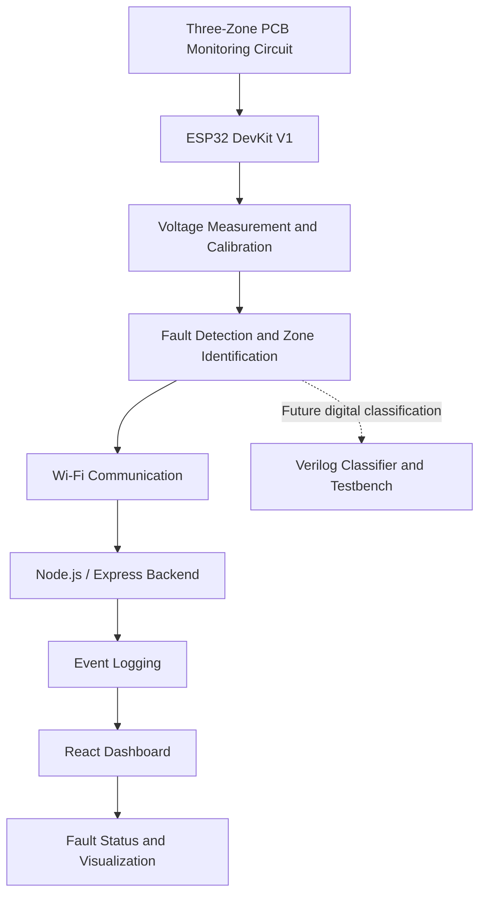

# CircuitSentry – System Architecture

## Intelligent PCB Fault Fingerprinting and Localization

CircuitSentry is a low-cost, ESP32-based PCB monitoring system designed to detect abnormal voltage conditions across multiple circuit zones and identify the likely location of electrical faults.

The system combines embedded monitoring, fault detection, backend communication, and a web-based dashboard to provide a centralized view of circuit health.

---

## 1. System Overview

The proposed CircuitSentry system is divided into five major layers:

1. Hardware Monitoring Layer
2. Embedded Processing Layer
3. Backend Communication Layer
4. Frontend Visualization Layer
5. Verification and Classification Layer

### 1.1 System Architecture Diagram



The ESP32 monitors voltage levels from different circuit zones. The measured values are processed to identify abnormal conditions. The backend receives the readings and stores fault events, while the dashboard presents the system status to the user.

---

## 2. System Components

### 2.1 Hardware Monitoring Layer

The hardware layer consists of an ESP32 development board connected to a three-zone voltage monitoring circuit.

**Primary components:**

| Component | Purpose |
|:---|:---|
| ESP32 DevKit V1 | Main microcontroller |
| Voltage Divider Circuits | Scale voltage for ADC measurement |
| Resistors | Build monitoring and sensing circuits |
| Push Buttons | Simulate electrical fault conditions |
| LEDs | Provide visual status indication |
| Breadboard | Hardware prototyping |
| Jumper Wires | Electrical connections |

**Monitoring Zones:**

- Zone A – First circuit monitoring point.
- Zone B – Second circuit monitoring point.
- Zone C – Third circuit monitoring point.

Each zone provides a voltage measurement that is compared against its calibrated baseline.

The prototype uses controlled low-voltage test circuits to demonstrate fault detection.

### 2.2 Embedded Processing Layer

The ESP32 acts as the central embedded processing unit.

**Main responsibilities:**

- Read analog voltage measurements using ADC inputs.
- Establish baseline voltage values during calibration.
- Compare measured values against predefined thresholds.
- Identify abnormal voltage conditions.
- Determine the likely affected monitoring zone.
- Transmit monitoring information through Wi-Fi.

**Planned ADC pin assignments:**

| Monitoring Zone | ESP32 GPIO |
|:---|:---|
| Zone A | GPIO 34 |
| Zone B | GPIO 35 |
| Zone C | GPIO 32 |

The ESP32 firmware is developed using Arduino C++.

The initial firmware includes baseline calibration, voltage sampling, averaging, and threshold-based fault detection.

### 2.3 Backend Communication Layer

The backend is developed using Node.js and Express.js.

It acts as the communication interface between the monitoring system and the frontend dashboard.

**Main responsibilities:**

- Receive voltage readings through HTTP requests.
- Validate incoming device data.
- Process three-zone voltage information.
- Maintain fault event history.
- Provide monitoring data through REST API endpoints.

**Implemented API endpoints:**

| Method | Endpoint | Description |
|:---|:---|:---|
| GET | `/` | API information |
| GET | `/api/health` | Backend health status |
| POST | `/api/data` | Submit voltage readings |
| GET | `/api/events` | Retrieve stored readings and events |

**Current storage:**

The initial backend uses in-memory storage with a maximum history of 200 records.

Persistent database integration is planned for a future development phase.

### 2.4 Frontend Visualization Layer

The frontend is developed using React, TypeScript, Vite, and CSS.

It provides a dashboard for visualizing the monitoring system.

**Main dashboard features:**

- Three-zone monitoring cards.
- Voltage reading display.
- Normal and fault status indicators.
- Active fault count.
- Fault event information.
- Last update timestamp.
- Simulated fault and recovery controls.
- Backend connectivity status.

The dashboard communicates with the Express backend using HTTP API requests.

The current prototype supports simulated readings and backend integration.

### 2.5 Verification and Classification Layer

This layer focuses on validating fault detection and improving fault localization.

**Planned components:**

- Verilog-based fault classification module.
- Self-checking testbench with PASS/FAIL results.
- Digital fault identification logic.
- Comparison of simulated and measured fault scenarios.
- Evaluation of classification accuracy.

The Verilog module is planned as a digital classification component. It is not currently integrated with the ESP32 hardware.

---

## 3. Data Flow

### 3.1 Monitoring Data Flow

The intended system data flow is:

```text
Three-Zone Monitoring Circuit
              |
              v
         ESP32 ADC
              |
              v
     Baseline Calibration
              |
              v
       Fault Detection
              |
              v
       Wi-Fi Communication
              |
              v
       Backend REST API
              |
              v
         Event Logging
              |
              v
       React Dashboard
              |
              v
      Fault Visualization
```

### 3.2 Fault Detection Process

1. The ESP32 reads voltage values from the three monitoring zones.
2. The measured values are compared against calibrated baseline values.
3. If a reading exceeds the configured deviation threshold, an abnormal condition is detected.
4. The affected zone is identified based on the measured deviation.
5. The reading and device information are transmitted to the backend.
6. The backend validates and stores the received information.
7. The frontend retrieves the latest readings and displays the fault status.

### 3.3 Example Fault Scenario

Consider a three-zone monitoring system with the following readings:

| Zone | Normal Voltage | Measured Voltage | Status |
|:---|---:|---:|:---|
| Zone A | 1.65 V | 1.65 V | Normal |
| Zone B | 1.65 V | 0.65 V | Fault |
| Zone C | 1.65 V | 1.65 V | Normal |

In this simulated scenario, Zone B shows an abnormal voltage deviation.

The system identifies Zone B as the suspected faulty zone and reports the condition through the backend and dashboard.

---

## 4. Development Status

CircuitSentry is currently in the software prototype and hardware development phase.

The initial software implementation is operational, with simulated fault detection and frontend-backend integration. Physical hardware implementation and advanced fault classification are planned next.

### 4.1 Implementation Overview

| Component | Technology | Current Status |
|:---|:---|:---|
| Project Documentation | Markdown | Completed |
| ESP32 Firmware | Arduino C++ | Initial Version |
| Backend API | Node.js, Express | Completed |
| Event Logging | In-memory Storage | Completed |
| Frontend Dashboard | React, TypeScript | Completed |
| Simulated Fault Detection | Python / React | Tested |
| Three-Zone Hardware | ESP32, Sensors | Pending |
| Fault Fingerprinting | Classification Logic | Pending |
| Digital Classifier | Verilog | Pending |
| Database Integration | Persistent Storage | Pending |

### 4.2 Completed Tasks

The following components have been implemented and tested in the software prototype:

- [x] Initial project README and architecture documentation.
- [x] Initial ESP32 monitoring firmware file.
- [x] Backend API development using Node.js and Express.
- [x] Backend fault event logging using in-memory storage.
- [x] React and TypeScript dashboard development.
- [x] Simulated three-zone voltage monitoring.
- [x] Frontend and backend integration.
- [x] Simulated fault detection and recovery testing.
- [x] GitHub repository setup and project upload.

### 4.3 Pending Development Tasks

The following tasks are planned for the next development phase:

- [ ] Build the three-zone physical hardware prototype.
- [ ] Perform hardware baseline calibration.
- [ ] Validate voltage measurement and fault detection.
- [ ] Test physical fault event logging.
- [ ] Implement persistent database storage.
- [ ] Develop advanced fault fingerprint matching.
- [ ] Implement the Verilog fault classifier.
- [ ] Develop and simulate the Verilog testbench.
- [ ] Integrate live ESP32 readings with the backend.
- [ ] Perform complete hardware-to-dashboard testing.

### 4.4 Current Development Milestones

**Milestone 1 – Software Prototype**

The initial software prototype is operational.

The React dashboard communicates with the Node.js backend and displays simulated voltage readings from three monitoring zones. Fault conditions can be simulated, transmitted to the backend, and displayed on the dashboard.

**Milestone 2 – Physical Hardware Implementation (Upcoming)**

The next phase focuses on:

1. Building the three-zone monitoring circuit using the ESP32 DevKit V1.
2. Measuring voltage levels from each monitoring zone.
3. Implementing baseline calibration and fault detection.
4. Sending real hardware readings to the backend.
5. Displaying actual hardware fault events on the dashboard.

**Milestone 3 – Advanced Fault Classification (Planned)**

- Develop fault fingerprint matching.
- Implement the Verilog classification module.
- Create a self-checking testbench.
- Evaluate classification performance using different fault scenarios.

### 4.5 Future Enhancements

| Enhancement | Objective |
|:---|:---|
| Persistent Data Storage | Maintain fault history across server restarts |
| Improved Fault Detection | Increase detection reliability through calibration and filtering |
| Fault Fingerprinting | Identify recurring fault patterns |
| Verilog Classifier | Implement digital fault classification |
| Real-Time Alerts | Notify users when abnormal conditions occur |
| Performance Evaluation | Measure detection speed and system reliability |

---

## 5. Current Limitations

CircuitSentry is an evolving prototype. The architecture describes the intended system design, and not every proposed feature has been implemented or physically validated.

### 5.1 Hardware Limitations

- Physical ESP32 integration and three-zone hardware validation are pending.
- ADC readings may be affected by electrical noise and calibration errors.
- The initial prototype is designed for controlled, low-voltage test circuits.
- Detecting very short electrical transients may require faster sampling or additional hardware.
- Ambient temperature and humidity measurements do not directly represent PCB surface temperature.

### 5.2 Software Limitations

- Backend event history currently uses in-memory storage.
- Recorded events are lost when the backend server restarts.
- Advanced fault fingerprint matching is not yet implemented.
- The current dashboard supports simulated readings; live hardware integration remains pending.
- Device authentication and secure communication require further implementation.

### 5.3 Classification Limitations

- The Verilog classifier and testbench are planned but not yet implemented.
- Simultaneous faults and complex fault patterns require additional classification logic.
- Fault localization accuracy must be evaluated using actual hardware test cases.
- The Verilog classifier requires a suitable digital interface if it is to process measurements from the ESP32 system.

### 5.4 Safety and Testing Considerations

- The prototype is intended for controlled, low-voltage experimental circuits.
- Mains electricity must never be connected directly to ESP32 inputs.
- ADC input voltages must remain within the permitted ESP32 limits.
- Appropriate voltage conditioning and protection must be used for external signals.
- Each feature must undergo individual testing before being considered operational.

> **Note:** Simulated results are not considered proof of physical hardware performance. Development status is updated as implementation and validation progress.

---

## 6. Future Scope

CircuitSentry can be extended into a more advanced PCB monitoring and diagnostic platform.

Potential improvements include:

- Multi-channel voltage and current monitoring.
- Persistent fault event storage and historical analysis.
- Advanced fault fingerprinting using machine learning.
- FPGA-based digital fault classification.
- Hardware-assisted transient detection.
- Remote monitoring and notification services.
- PCB health reports and diagnostic analytics.

The long-term objective is to develop a reliable, affordable, and modular platform for identifying abnormal electrical behavior and assisting PCB fault localization.

---

## 7. Conclusion

CircuitSentry combines embedded systems, web technologies, and digital hardware design to demonstrate an approach to PCB fault monitoring and localization.

The initial software prototype establishes the foundation for three-zone monitoring, simulated fault detection, backend communication, and dashboard visualization.

Future development will focus on physical hardware validation, advanced fault fingerprinting, Verilog-based classification, and complete end-to-end testing.
